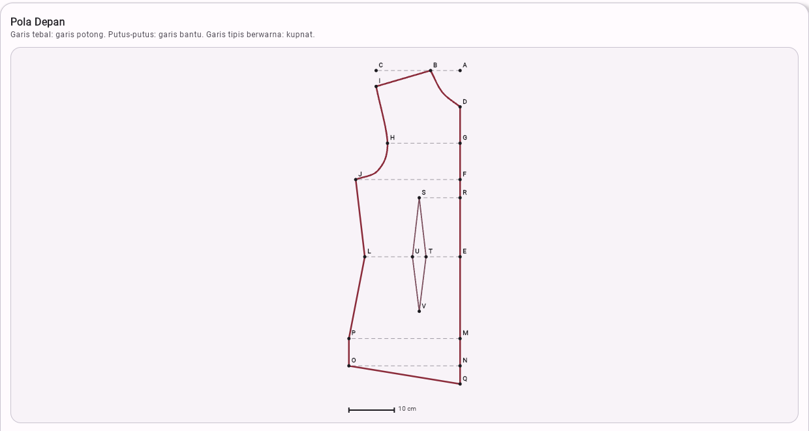
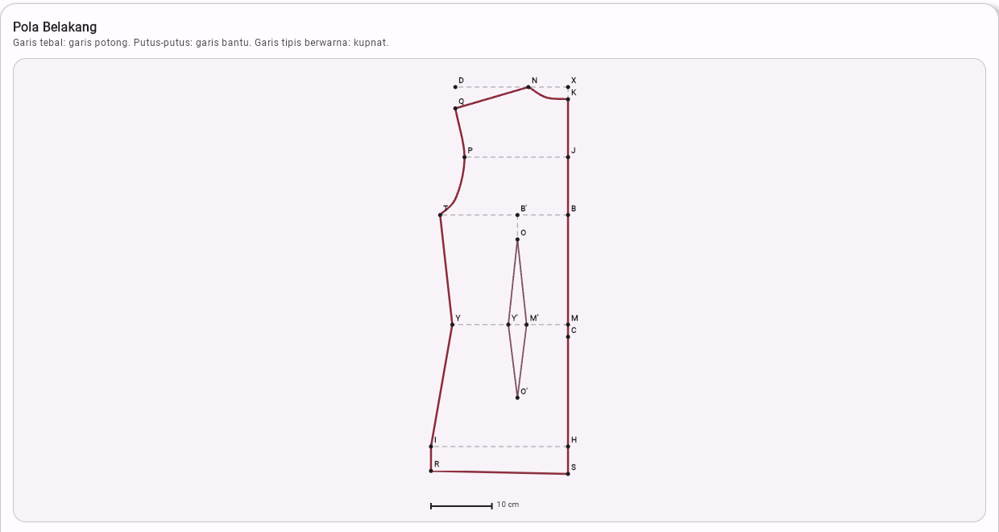
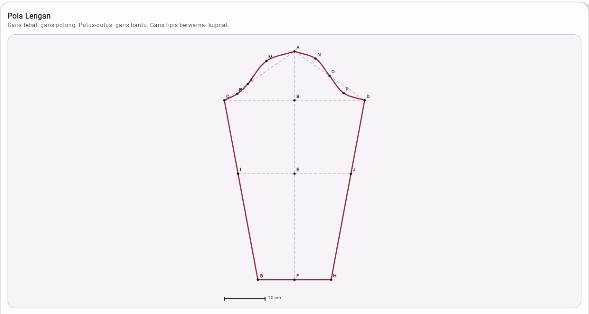
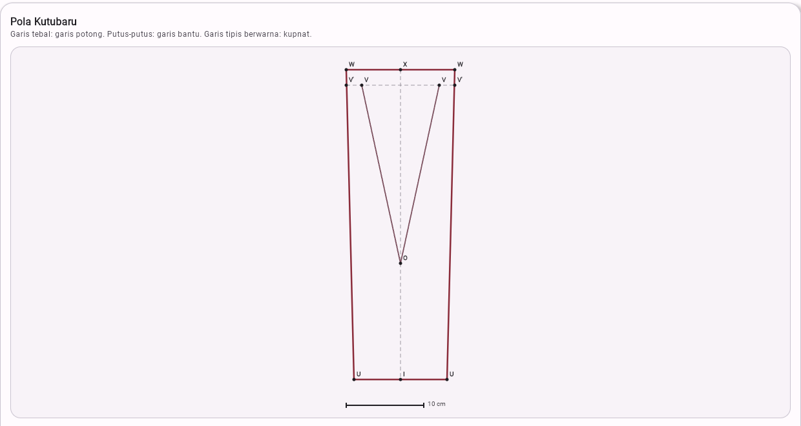

# Smart Kebaya Pattern Generator

**Drafts a made-to-measure kebaya pattern (front, back, sleeve and *kutubaru* facing) from 15 body measurements, and draws it to scale.** Android app and web app from one Kotlin codebase (Compose Multiplatform).

[](https://github.com/vacelni/smart-kebaya-pattern/actions/workflows/build.yml)


> **Try it in the browser:** [vacelni.github.io/smart-kebaya-pattern](https://vacelni.github.io/smart-kebaya-pattern/). Tap *Isi contoh ukuran (M)*, then *Generate pola*. The Android APK is attached to every CI run.

| Front | Back | Sleeve | Kutubaru |
|---|---|---|---|
|  |  |  |  |

## Why

Built during my internship at IT Pedia for a vocational fashion-design course (*Desain dan Produksi Busana*). Students learn to draft a kebaya by hand from a module of formulas, lettered points and reference drawings. Drafting takes a class period, and a single arithmetic slip ruins the pattern. The app does the arithmetic and the drawing, so students can check their own draft and teachers can check a whole class quickly.

## What it does

- Takes 15 measurements, in cm or inches. Values are converted when you switch units, and both the Indonesian decimal comma (`33,5`) and the decimal point are accepted.
- Validates every field against a plausible range (to catch `880` typed for `88.0`) and checks the relations the draft depends on, for example that the kebaya is long enough to pass the hips. Each error appears under its own field.
- **Drafts each piece geometrically.** Every lettered point of the module (A, B, C … Q) is computed in centimetres and joined with straight lines, construction lines, darts and smooth curves (neckline, armhole, sleeve cap). The pieces are drawn to scale with a 10 cm bar.
- Exports a PDF on Android with the same vector drawings, the scale, and a table of every measurement.

## How the drafting works

`KebayaCalculator` turns `MeasurementInputs` into a `PatternDrawing` for each piece: named points, plus paths through them marked as outline, construction or dart. The screen (`PatternDrawingCanvas`) and the Android PDF (`PdfUtil`) both draw from that one model, so they cannot disagree.

Curves are uniform Catmull-Rom splines through the drafting points, so the neckline really passes through B and D and the sleeve cap through K, M, N, O and P, as a tailor would draw them with a curve ruler. The sleeve cap's raised and hollowed points (M +2 cm, N +1.5, P −1.5, R −0.5) are offsets perpendicular to the guide lines A-C and A-D, and the cap seam on each side equals half the armhole, as the module specifies.

### Where the module disagreed with itself

Turning the reference drawings into geometry exposed four places where the module's formulas and its own drawings did not match. Each one was decided with the course owner, and the drawing won every time:

| Piece | Module formula | Drawing shows | Implemented |
|---|---|---|---|
| Front | D-F = D-E **+** E-F | F (armpit line) lies *above* E (waist) | D-F = D-E − E-F |
| Front | E-N = kebaya length | Length measured from the shoulder (measuring guide) | N at kebaya length from the shoulder line |
| Front | R-S = 18 cm | Dart apex S above the dart's centre (~9 cm) | S above the centre of U-T |
| Kutubaru | X-I = 30, I-U = 2 | X-I = 40, I-U = 6, X-W = 7 printed on the drawing | Drawing's numbers |

The back's hem is placed as far below the waist as the front's, so the two side seams are the same length and can be sewn together. The module's reference drawings are in [`docs/reference/`](docs/reference/).

## Tests

`composeApp/src/commonTest` covers the drafting rules (neck width, waist with dart intake, D-F, kebaya length, dart position) and the geometric guarantees:

- the back hem matches the front;
- the sleeve-cap seam equals half the armhole;
- curves pass through their end points;
- every path resolves and every coordinate is finite;
- the pattern grows with the body.

It also covers validation: required fields, ranges, unit-aware messages, cross-field rules, and the decimal comma.

```bash
./gradlew :composeApp:testDebugUnitTest            # tests
./gradlew :composeApp:assembleDebug                # Android APK
./gradlew :composeApp:wasmJsBrowserDevelopmentRun  # web app on localhost
```

Requires JDK 17+ (set `JAVA_HOME`). CI runs the tests, builds the APK and publishes the web build to GitHub Pages.

## Tech stack

Kotlin 2.1 · Compose Multiplatform 1.7 (Android + Kotlin/Wasm) · Material 3 · AndroidX ViewModel + StateFlow · Compose Canvas · `android.graphics.pdf` · kotlin.test · GitHub Actions + Pages

## License

[MIT](LICENSE) © Vacelnino Faiz Fadeli. The pattern-drafting method belongs to the course module.
